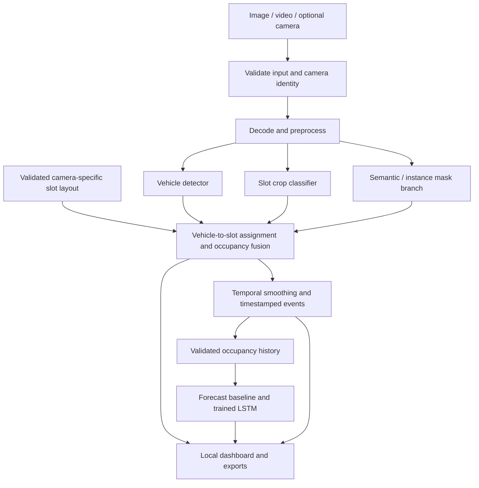
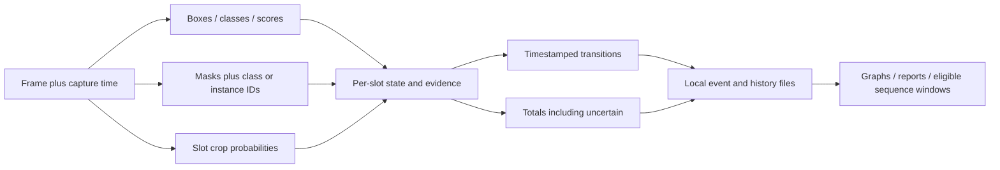
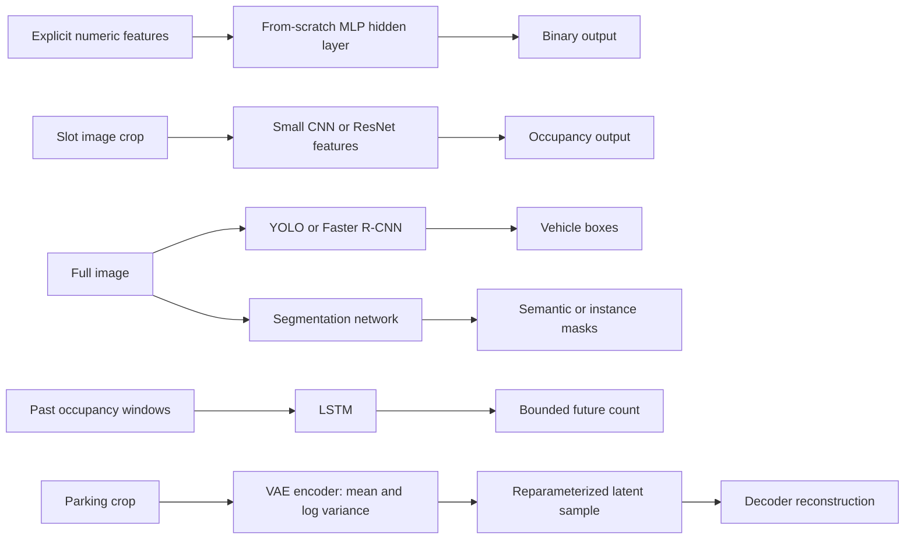
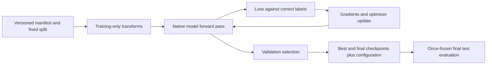
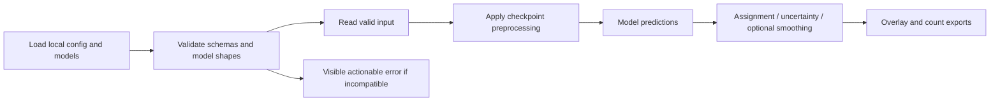
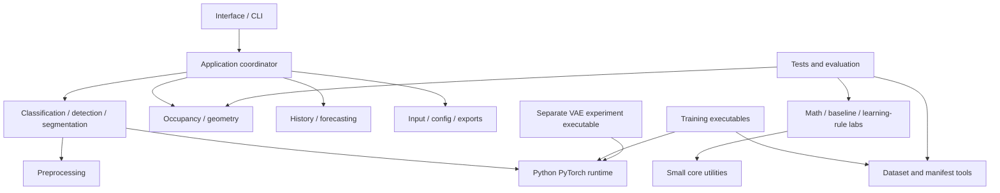
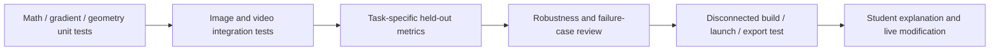
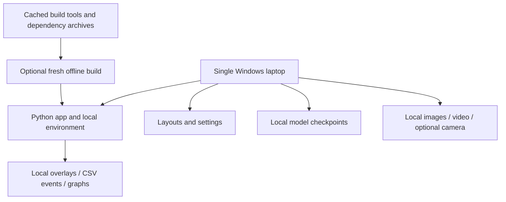

# Target architecture — design only

**Implementation update:** Python/Jupyter is active. The dataset preparation module and audit notebook exist; all model/application boxes remain targets. Python PyTorch replaces the original native-runtime proposal. No model has been trained.

The diagrams describe the target application. Supporting data preparation is implemented; model choices still await the university audit and model smoke tests.

## 1. System architecture

The system looks at a view of the lot, gathers evidence for each configured
space, then displays counts. A separate history branch predicts later counts
only when compatible observations and a trained model exist. Segmentation is a
distinct learned branch; manually drawn slot regions are configuration data.

## 2. Data-flow diagram

A frame becomes structured evidence. Evidence becomes slot states and counts;
these outputs are saved with provenance so results can be reproduced.

## 3. Model architecture sketches

Each model answers a different question: classify a slot, locate a vehicle,
label pixels, predict a later count, or reconstruct/generate image patches.
These are not interchangeable tasks. Exact layers and shapes will be documented
when architecture and data dimensions are selected.

## 4. Training pipeline

Training changes weights. Validation selects settings/checkpoints. The held-out
test set evaluates the frozen procedure. Manual gradients are required for the
baseline; Python PyTorch can provide autodiff for the main models.

## 5. Inference pipeline

Inference uses saved weights without learning new ones. Missing models or a
wrong camera layout produce clear errors rather than fabricated outputs.

## 6. Module dependencies

The interface calls small modules with clear inputs/outputs. The VAE lab stays
separate so an experimental generative model cannot prevent occupancy analysis.

## 7. Data preparation

Check provenance and grouping before producing training examples. Splitting
after augmentation would risk putting copies of the same input on both sides.

## 8. Testing and evaluation

Correct small components are necessary but insufficient. The complete product
also needs real unseen-data evaluation, offline operation and student mastery.

## 9. Deployment

The proposed demonstration uses one computer with all needed files stored
locally. Successful offline execution and successful offline rebuilding are
separate claims and require separate evidence.

## Proposed module contracts

- `Frame`: image, source/camera ID, capture time and sequence identity. For still
  images without trusted time, do not silently use processing time as capture time.
- `SlotLayout`: camera ID, reference image size, unique slot IDs and valid polygons.
  Reject a mismatched view; scale only when documented geometry allows it.
- `Detection`: vehicle class, bounding box, score and frame reference. A raw score
  is not automatically calibrated confidence.
- `MaskPrediction`: pixel labels or per-instance masks with explicit task type.
- `SlotObservation`: slot ID, occupied/vacant/uncertain, supporting evidence,
  model version and timestamp validity.
- `CountSummary`: total, occupied, vacant, uncertain. Enforce
  `total = occupied + vacant + uncertain`; uncertainty is never counted as free.
- `Forecast`: target time/horizon, capacity, predicted count, model/dataset
  provenance and real/simulated flag. Reject insufficient history and incompatible
  sampling intervals. Document clipping or another bounded output mechanism.

## Occupancy and vehicle-flow decisions

Candidate evidence includes crop probabilities and vehicle-slot overlap. Use
one-to-one assignment where appropriate to reduce double-counting, with an
explicit ambiguous state for occlusion and neighboring-slot conflicts. A missing
detection alone must not prove vacancy. Calibrate thresholds on validation data.
Temporal smoothing must reset on unrelated inputs, camera changes or sequence gaps.

Slot state changes are occupancy events. Actual entrance/exit flow requires
track identities and verified line/zone crossings in suitable footage. Do not
label state changes as entrance/exit counts. Debounced occupancy events are implemented; entrance/exit tracking remains unimplemented.
